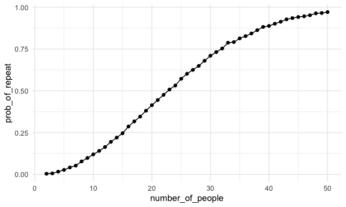
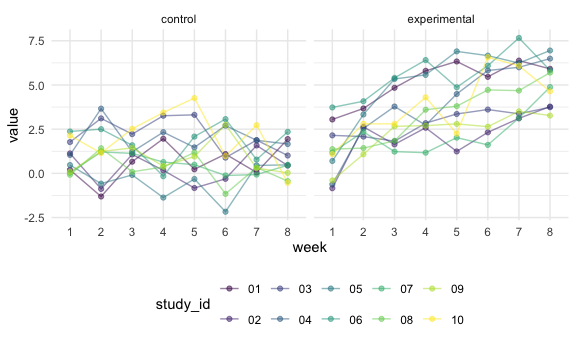

p8105_hw5
================
Alexa Burko
2026-11-10

# Setup and Libraries

``` r
set.seed(1236)
```

## Problem 1

Created function. It is in `source/birthday_repeated.R`

### Run this function 10000 times for each group size between 2 and 50.

``` r
source("source/birthday_repeated.R")

birthday_results_df =
  expand_grid(
    number_of_people = 2:50,
    iter = 1:10000
  ) |> 
  mutate(
    repeated = map_lgl(number_of_people, birthday_repeated)
  )

birthday_results_df
```

    ## # A tibble: 490,000 × 3
    ##    number_of_people  iter repeated
    ##               <int> <int> <lgl>   
    ##  1                2     1 FALSE   
    ##  2                2     2 FALSE   
    ##  3                2     3 FALSE   
    ##  4                2     4 FALSE   
    ##  5                2     5 FALSE   
    ##  6                2     6 FALSE   
    ##  7                2     7 FALSE   
    ##  8                2     8 FALSE   
    ##  9                2     9 FALSE   
    ## 10                2    10 FALSE   
    ## # ℹ 489,990 more rows

### For each group size, compute the probability that at least two people in the group will share a birthday by averaging across the 10000 simulation runs

``` r
birthday_results_df |> 
  group_by(number_of_people) |> 
  summarize(prob_of_repeat = mean(repeated)) 
```

    ## # A tibble: 49 × 2
    ##    number_of_people prob_of_repeat
    ##               <int>          <dbl>
    ##  1                2         0.0042
    ##  2                3         0.0063
    ##  3                4         0.0165
    ##  4                5         0.0271
    ##  5                6         0.0418
    ##  6                7         0.0524
    ##  7                8         0.0777
    ##  8                9         0.0985
    ##  9               10         0.120 
    ## 10               11         0.141 
    ## # ℹ 39 more rows

### Plot showing the probability as a function of group size

``` r
birthday_results_df |> 
  group_by(number_of_people) |> 
  summarize(prob_of_repeat = mean(repeated)) |> 
  ggplot(aes(x = number_of_people, y = prob_of_repeat)) +
  geom_point() +
  geom_line()
```



This plot shows that the greater the group size, the higher the
probability that two people in the group will share a birthday. There
only needs to be about 23 people in the group for there to be a 50%
chance that two people in the group will share a birthday.

## Problem 2

``` r
study_df = 
  tibble(
files = list.files("data/data"))
```

``` r
source("source/file_import.R")

study_df = study_df |> 
  mutate(
    file_df = map(files, file_import)
    ) |> 
  unnest(file_df) |> 
    separate(col = files, into = c("arm", "study_id"), sep = "_") |> 
  mutate(
    arm = case_match(
      arm,
      "con" ~ "control",
      "exp" ~ "experimental"
    ),
    study_id = str_remove(study_id, "\\.csv")
  )

study_df
```

    ## # A tibble: 160 × 4
    ##    arm     study_id week  value
    ##    <chr>   <chr>    <chr> <dbl>
    ##  1 control 01       1      0.2 
    ##  2 control 01       2     -1.31
    ##  3 control 01       3      0.66
    ##  4 control 01       4      1.96
    ##  5 control 01       5      0.23
    ##  6 control 01       6      1.09
    ##  7 control 01       7      0.05
    ##  8 control 01       8      1.94
    ##  9 control 02       1      1.13
    ## 10 control 02       2     -0.88
    ## # ℹ 150 more rows

``` r
study_df |> 
ggplot(aes(x = week, y = value, group = study_id, color = study_id)) +
  geom_line(alpha = 0.5) +
  geom_point(alpha = 0.5) +
  facet_grid(~arm)
```


Those in the control arm have lower values on average compared to those
in the experimental arm. While the values of those in the experimental
arm tend to increase as the weeks go on, the values of those in the
control arm tend to stay the same or decrease.
